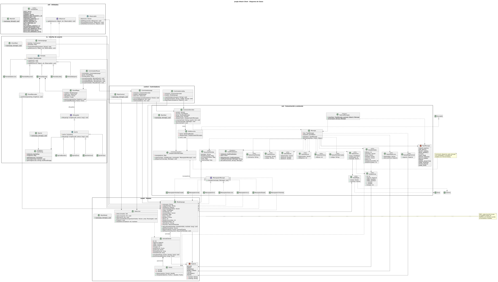

# Jungle Attack Client 


Repo jungle-attack-client. El cliente no tiene reglas del juego: envía las intenciones del jugador al servidor y dibuja lo que recibe. Sigue MVC con el Observer de util, y cada paquete tiene su clase Main para pruebas unitarias.

## Patrón Observer y Utilidades (util)

Mismo paquete que en jungle-attack-server.

### IObserver (Interfaz)

Métodos:

- update(Object source, Observable ob): void — Notifica al observador cuando ocurre un cambio en el objeto observado.

### Observable (Clase Abstracta)

Atributos:

- observers: Vector — Colección de observadores suscritos.

Métodos:

- addObserver(IObserver ob): void
- removeObserver(IObserver ob): void
- notifyObservers(Object source): void — Invoca update(source, this) sobre cada observador registrado.

### Constantes

Clase no instanciable que concentra todos los valores constantes y configuraciones del cliente.

Variables principales:

- Red: HOST, PUERTO, CHARSET ("UTF-8").
- Juego (para mostrar en pantalla): ENERGIA\_MAX\_JUGADOR (20), ENERGIA\_BOT (10), CANTIDAD\_ESPECIES (7), LARGO\_CODIGO (4).
- Aspectos Gráficos: ANCHO\_VENTANA, ALTO\_VENTANA, FPS (30), ALTO\_BARRA\_ENERGIA, COLOR\_SELECCION, RUTA\_SVG\_ANIMALES, RUTA\_SVG\_TAZA, RUTA\_SVG\_BANDERA.

### MainUtil

Prueba unitaria independiente para verificar que Observable registra, quita y notifica observadores.

## 1. Network Layer (red)

Las clases de protocolo (TipoMensaje, Mensaje, CodificadorJson, FabricaMensajes y DTOs) son iguales a las del servidor; si cambian en un repo, se cambian en el otro.

### TipoMensaje (Enum)

Valores: CREATE\_MATCH, JOIN\_MATCH, SELECT\_ANIMAL, MOVE\_ANIMALS, ATTACK, VIEW\_ZONE, MATCH\_CREATED, MATCH\_JOINED, ERROR, ANIMAL\_SELECTION, GAME\_STARTED, STATE\_UPDATE, GAME\_OVER

### Mensaje

Sobre de cada mensaje JSON: una línea por mensaje.

Atributos:

- tipo: TipoMensaje
- payload: JsonObject

Métodos:

- getTipo(): TipoMensaje
- getPayload(Class tipo): Object — Convierte el payload al DTO indicado.

### CodificadorJson — Patrón Singleton

Atributos:

- instancia: CodificadorJson (estático)
- gson: Gson

Métodos:

- getInstancia(): CodificadorJson (estático)
- codificar(Mensaje mensaje): String
- decodificar(String linea): Mensaje

### FabricaMensajes — Patrón Factory

Clase no instanciable.

Métodos:

- crear(TipoMensaje tipo, Object payload): Mensaje (estático)
- error(String razon): Mensaje (estático)

### DTOs (objetos de transferencia de datos)

- DatosCrearPartida: nickname: String
- DatosUnirse: nickname: String, codigo: String
- DatosElegirAnimal: especie: Especie
- DatosMover: idsAnimales: Vector, destinoX: double, destinoY: double
- DatosAtacar: idsAnimales: Vector, idObjetivo: int
- DatosVerZona: idZona: int
- DatosPartidaCreada: codigo: String
- DatosSeleccion: disponibles: Vector, eleccionRival: Especie
- DatosInicio: mapa: VistaMapa, zonaPropia: int, manada: Vector
- EstadoVisible: idZona: int, animales: Vector, tazas: Vector, bandera: Punto, eventos: Vector, danio: int, tazasConsumidas: int, botsEliminados: int
- ResumenPartida: ganador: String, botsEliminados: Map, animalesPerdidos: Map, tazas: Map, duracionSeg: long
- VistaAnimal: id: int, especie: Especie, esBot: boolean, esMio: boolean, x: double, y: double, energia: int
- VistaMapa: zonas: Vector, caminos: Vector

### ConexionServidor

Atributos:

- socket: Socket
- escritor: PrintWriter
- lector: BufferedReader
- hiloEscucha: Thread
- despachador: DespachadorMensajes

Métodos:

- conectar(String host, int puerto): void
- enviar(Mensaje mensaje): void
- desconectar(): void — Cierra el socket en finally.

### HiloEscucha (Implementa Runnable)

Lee los mensajes del servidor en un hilo aparte del de la interfaz.

Atributos:

- lector: BufferedReader
- despachador: DespachadorMensajes

Métodos:

- run(): void — Lee una línea por mensaje; nunca toca componentes Swing directamente.

### DespachadorMensajes — Command: invocador

Atributos:

- manejadores: Map — Un IManejadorMensaje por cada TipoMensaje.

Métodos:

- registrar(TipoMensaje tipo, IManejadorMensaje manejador): void
- despachar(Mensaje mensaje): void — Pasa al hilo de Swing con SwingUtilities.invokeLater.

### IManejadorMensaje (Interfaz) — Patrón Command

Métodos:

- manejar(Mensaje mensaje): void

### Manejadores (Implementan IManejadorMensaje)

ManejadorPartidaCreada, ManejadorUnido, ManejadorError, ManejadorSeleccion, ManejadorInicio, ManejadorEstado y ManejadorFinPartida. Cada uno actualiza el ModeloJuego.

### MainRed

Prueba unitaria independiente para verificar la ida y vuelta a JSON de cada tipo de mensaje y que cada mensaje llegue a su manejador.

## 2. Model Layer (model)

### Punto

Atributos:

- x: double
- y: double

Métodos:

- distancia(Punto otro): double
- interpolar(Punto destino, double t): Punto — Punto intermedio entre los dos, con t de 0.0 a 1.0.

### Especie (Enum)

Las 7 especies nativas de Costa Rica; igual que en el servidor.

Valores: JAGUAR, DANTA, PEREZOSO, MONO\_CONGO, TUCAN, COCODRILO, PIZOTE

Atributos:

- nombre: String
- rutaSvg: String

### ModeloJuego (Hereda de Observable) — Observer: sujeto

Copia local de lo que el jugador puede ver.

Atributos:

- nickname: String
- codigoPartida: String
- miEspecie: Especie
- especiesDisponibles: Vector
- mapa: VistaMapa
- zonaActual: int
- zonasVisibles: Vector
- animales: Map
- tazas: Vector
- bandera: Punto
- danio: int
- tazasConsumidas: int
- botsEliminados: int
- ultimoError: String
- resumen: ResumenPartida

Métodos:

- aplicarEstado(EstadoVisible estado, long recibido): void — Actualiza todo y dispara notificaciones.
- getMisAnimales(): Vector
- getAnimalEn(Punto p): AnimalCliente
- setResumen(ResumenPartida resumen): void

### AnimalCliente

Atributos:

- id: int
- especie: Especie
- esBot: boolean
- esMio: boolean
- energia: int
- posAnterior: Punto
- posActual: Punto
- tiempoAnterior: long
- tiempoActual: long

Métodos:

- actualizarPos(Punto p, long tiempo): void
- posInterpolada(long ahora): Punto — Suaviza el movimiento entre los dos últimos snapshots.

### Seleccion

Atributos:

- seleccionados: Set

Métodos:

- seleccionar(int id): void
- alternar(int id): void
- seleccionarEnRectangulo(Vector animales, Rectangle area): void
- limpiar(): void
- estaSeleccionado(int id): boolean

### MainModel

Prueba unitaria independiente para verificar que aplicarEstado notifique a los observadores, la selección múltiple y la interpolación.

## 3. Control Layer (control)

### ControladorLobby

Atributos:

- conexion: ConexionServidor
- modelo: ModeloJuego

Métodos:

- crearPartida(String nickname): void — Envía CREATE\_MATCH.
- unirse(String nickname, String codigo): void — Envía JOIN\_MATCH.
- elegirEspecie(Especie especie): void — Envía SELECT\_ANIMAL.

### ControladorJuego

Convierte las acciones del mouse en mensajes al servidor.

Atributos:

- conexion: ConexionServidor
- modelo: ModeloJuego
- seleccion: Seleccion

Métodos:

- moverSeleccionados(Punto destino): void — Envía MOVE\_ANIMALS.
- atacar(int idObjetivo): void — Envía ATTACK.
- verZona(int idZona): void — Envía VIEW\_ZONE.

### MainControl

Prueba unitaria independiente con una conexión simulada para verificar que se envíen los mensajes correctos.

## 4. UI Layer (iu)

### VentanaJuego (Hereda de JFrame, Implementa IObserver)

Ventana principal; cambia de pantalla según el estado del modelo.

Atributos:

- tarjetas: CardLayout
- pantallas: Map

Métodos:

- mostrarPantalla(String nombre): void
- update(Object source, Observable ob): void

### Pantalla (Clase Abstracta, Hereda de JPanel, Implementa IObserver)

Atributos:

- modelo: ModeloJuego

Métodos:

- construir(): void (abstracto)
- refrescar(): void (abstracto)
- update(Object source, Observable ob): void — Llama a refrescar.

### Pantallas (Heredan de Pantalla)

- PantallaLobby: Pide el nickname y permite crear partida o unirse con código.
- PantallaEspera: Muestra el código mientras llega el segundo jugador.
- PantallaSeleccion: Las 7 especies; las tomadas salen deshabilitadas.
- PantallaJuego: Contiene el PanelMapa y el PanelMarcador.
- PantallaResumen: Muestra bots eliminados, animales perdidos, tazas y duración.

### PanelMapa (Hereda de JPanel)

Canvas donde se dibuja la zona visible.

Atributos:

- modelo: ModeloJuego
- seleccion: Seleccion
- dibujables: Vector
- refresco: Timer — Aproximadamente 30 FPS.

Métodos:

- paintComponent(Graphics g): void
- pantallaAMundo(Point p): Punto

### IDibujable (Interfaz)

Métodos:

- dibujar(Graphics2D g2, long ahora): void

### Sprite (Clase Abstracta, Implementa IDibujable)

Atributos:

- cache: CacheSvg

Métodos:

- dibujar(Graphics2D g2, long ahora): void (abstracto)

### Sprites (Heredan de Sprite)

- SpriteZona: Fondo de la zona y sus caminos.
- SpriteAnimal: Imagen SVG, barra de energía y borde si está seleccionado.
- SpriteTaza: Taza de café.
- SpriteBandera: Bandera con su color.

### PanelMarcador (Hereda de JPanel)

Métodos:

- paintComponent(Graphics g): void — Dibuja el daño actual, tazas, bots eliminados y zonas con animales.

### CacheSvg — Patrón Singleton

Atributos:

- instancia: CacheSvg (estático)
- imagenes: Map

Métodos:

- getInstancia(): CacheSvg (estático)
- precargar(Vector rutas): void — Rasteriza cada SVG una sola vez al iniciar.
- getImagen(String ruta): BufferedImage

### ControladorMouse (Hereda de MouseAdapter)

Atributos:

- controlador: ControladorJuego
- panel: PanelMapa
- inicioArrastre: Point

Métodos:

- mousePressed(MouseEvent e): void
- mouseDragged(MouseEvent e): void — Dibuja el rectángulo de selección.
- mouseReleased(MouseEvent e): void
- mouseClicked(MouseEvent e): void — Clic izquierdo selecciona; clic derecho en un enemigo ataca y en el piso mueve.

### ClientMain

Métodos:

- main(String\[\] args): void (estático)

### MainIU

Prueba unitaria independiente para verificar que CacheSvg rasterice cada SVG una sola vez.

## Resumen de patrones, herencia y polimorfismo

| Patrón | Participantes | Para qué |
| --- | --- | --- |
| Observer | IObserver, Observable; sujeto: ModeloJuego; observadores: VentanaJuego, Pantalla | Redibujar la interfaz cuando llega un STATE\_UPDATE |
| MVC | ModeloJuego; VentanaJuego, pantallas y PanelMapa; ControladorJuego, ControladorLobby y ControladorMouse | Separar datos, dibujo y entrada del mouse |
| Command | IManejadorMensaje y manejadores con DespachadorMensajes | Una clase por tipo de mensaje en vez de un switch gigante |
| Factory | FabricaMensajes | Crear mensajes con el tipo y payload correctos |
| Singleton | CodificadorJson, CacheSvg | Un solo Gson y una sola caché de imágenes |

| Clase padre | Clases hijas | Métodos polimórficos |
| --- | --- | --- |
| Observable | ModeloJuego | notifyObservers() |
| Pantalla | PantallaLobby, PantallaEspera, PantallaSeleccion, PantallaJuego, PantallaResumen | construir(), refrescar() |
| Sprite | SpriteZona, SpriteAnimal, SpriteTaza, SpriteBandera | dibujar() |

Estáticos: todas las constantes de Constantes, ClientMain.main(), getInstancia() de los Singleton y los métodos de FabricaMensajes. No hay estado estático mutable.

## Diagrama UML

```
@startuml JungleAttackClient

title Jungle Attack Client - Diagrama de Clases

scale max 3000 width
skinparam packageStyle rectangle
skinparam linetype ortho
hide empty members

package "util - Utilidades" as Util {
    interface IObserver {
        +update(source: Object, ob: Observable): void
    }

    abstract class Observable {
        #observers: Vector
        +addObserver(ob: IObserver): void
        +removeObserver(ob: IObserver): void
        +notifyObservers(source: Object): void
    }

    class Constantes <<utility>> {
        {static} HOST: String
        {static} PUERTO: int
        {static} CHARSET: String
        {static} ENERGIA_MAX_JUGADOR = 20
        {static} ENERGIA_BOT = 10
        {static} CANTIDAD_ESPECIES = 7
        {static} LARGO_CODIGO = 4
        {static} ANCHO_VENTANA: int
        {static} ALTO_VENTANA: int
        {static} FPS = 30
        {static} ALTO_BARRA_ENERGIA: int
        {static} COLOR_SELECCION: Color
        {static} RUTA_SVG_ANIMALES: String
        {static} RUTA_SVG_TAZA: String
        {static} RUTA_SVG_BANDERA: String
    }

    class MainUtil {
        {static} +main(args: String[]): void
    }
}

package "red - Comunicación y protocolo" as Red {
    enum TipoMensaje {
        CREATE_MATCH
        JOIN_MATCH
        SELECT_ANIMAL
        MOVE_ANIMALS
        ATTACK
        VIEW_ZONE
        MATCH_CREATED
        MATCH_JOINED
        ERROR
        ANIMAL_SELECTION
        GAME_STARTED
        STATE_UPDATE
        GAME_OVER
    }

    class Mensaje {
        -tipo: TipoMensaje
        -payload: JsonObject
        +getTipo(): TipoMensaje
        +getPayload(tipo: Class): Object
    }

    class CodificadorJson <<Singleton>> {
        -{static} instancia: CodificadorJson
        -gson: Gson
        {static} +getInstancia(): CodificadorJson
        +codificar(mensaje: Mensaje): String
        +decodificar(linea: String): Mensaje
    }

    class FabricaMensajes <<Factory>> {
        {static} +crear(tipo: TipoMensaje, payload: Object): Mensaje
        {static} +error(razon: String): Mensaje
    }

    class DatosCrearPartida <<DTO>> {
        +nickname: String
    }
    class DatosUnirse <<DTO>> {
        +nickname: String
        +codigo: String
    }
    class DatosElegirAnimal <<DTO>> {
        +especie: Especie
    }
    class DatosMover <<DTO>> {
        +idsAnimales: Vector
        +destinoX: double
        +destinoY: double
    }
    class DatosAtacar <<DTO>> {
        +idsAnimales: Vector
        +idObjetivo: int
    }
    class DatosVerZona <<DTO>> {
        +idZona: int
    }
    class DatosPartidaCreada <<DTO>> {
        +codigo: String
    }
    class DatosSeleccion <<DTO>> {
        +disponibles: Vector
        +eleccionRival: Especie
    }
    class DatosInicio <<DTO>> {
        +mapa: VistaMapa
        +zonaPropia: int
        +manada: Vector
    }
    class EstadoVisible <<DTO>> {
        +idZona: int
        +animales: Vector
        +tazas: Vector
        +bandera: Punto
        +eventos: Vector
        +danio: int
        +tazasConsumidas: int
        +botsEliminados: int
    }
    class ResumenPartida <<DTO>> {
        +ganador: String
        +botsEliminados: Map
        +animalesPerdidos: Map
        +tazas: Map
        +duracionSeg: long
    }
    class VistaAnimal <<DTO>> {
        +id: int
        +especie: Especie
        +esBot: boolean
        +esMio: boolean
        +x: double
        +y: double
        +energia: int
    }
    class VistaMapa <<DTO>> {
        +zonas: Vector
        +caminos: Vector
    }

    class ConexionServidor {
        -socket: Socket
        -escritor: PrintWriter
        -lector: BufferedReader
        -hiloEscucha: Thread
        -despachador: DespachadorMensajes
        +conectar(host: String, puerto: int): void
        +enviar(mensaje: Mensaje): void
        +desconectar(): void
    }

    class HiloEscucha {
        -lector: BufferedReader
        -despachador: DespachadorMensajes
        +run(): void
    }

    interface IManejadorMensaje {
        +manejar(mensaje: Mensaje): void
    }

    class DespachadorMensajes <<Command Invoker>> {
        -manejadores: Map
        +registrar(tipo: TipoMensaje, manejador: IManejadorMensaje): void
        +despachar(mensaje: Mensaje): void
    }

    class ManejadorPartidaCreada
    class ManejadorUnido
    class ManejadorError
    class ManejadorSeleccion
    class ManejadorInicio
    class ManejadorEstado
    class ManejadorFinPartida

    class MainRed {
        {static} +main(args: String[]): void
    }
}

package "model - Modelo" as Model {
    class Punto {
        -x: double
        -y: double
        +distancia(otro: Punto): double
        +interpolar(destino: Punto, t: double): Punto
    }

    enum Especie {
        JAGUAR
        DANTA
        PEREZOSO
        MONO_CONGO
        TUCAN
        COCODRILO
        PIZOTE
        --
        -nombre: String
        -rutaSvg: String
    }

    class ModeloJuego {
        -nickname: String
        -codigoPartida: String
        -miEspecie: Especie
        -especiesDisponibles: Vector
        -mapa: VistaMapa
        -zonaActual: int
        -zonasVisibles: Vector
        -animales: Map
        -tazas: Vector
        -bandera: Punto
        -danio: int
        -tazasConsumidas: int
        -botsEliminados: int
        -ultimoError: String
        -resumen: ResumenPartida
        +aplicarEstado(estado: EstadoVisible, recibido: long): void
        +getMisAnimales(): Vector
        +getAnimalEn(p: Punto): AnimalCliente
        +setResumen(resumen: ResumenPartida): void
    }

    class AnimalCliente {
        -id: int
        -especie: Especie
        -esBot: boolean
        -esMio: boolean
        -energia: int
        -posAnterior: Punto
        -posActual: Punto
        -tiempoAnterior: long
        -tiempoActual: long
        +actualizarPos(p: Punto, tiempo: long): void
        +posInterpolada(ahora: long): Punto
    }

    class Seleccion {
        -seleccionados: Set
        +seleccionar(id: int): void
        +alternar(id: int): void
        +seleccionarEnRectangulo(animales: Vector, area: Rectangle): void
        +limpiar(): void
        +estaSeleccionado(id: int): boolean
    }

    class MainModel {
        {static} +main(args: String[]): void
    }
}

package "control - Controladores" as Control {
    class ControladorLobby {
        -conexion: ConexionServidor
        -modelo: ModeloJuego
        +crearPartida(nickname: String): void
        +unirse(nickname: String, codigo: String): void
        +elegirEspecie(especie: Especie): void
    }

    class ControladorJuego {
        -conexion: ConexionServidor
        -modelo: ModeloJuego
        -seleccion: Seleccion
        +moverSeleccionados(destino: Punto): void
        +atacar(idObjetivo: int): void
        +verZona(idZona: int): void
    }

    class MainControl {
        {static} +main(args: String[]): void
    }
}

package "iu - Interfaz de usuario" as IU {
    class VentanaJuego {
        -tarjetas: CardLayout
        -pantallas: Map
        +mostrarPantalla(nombre: String): void
        +update(source: Object, ob: Observable): void
    }

    abstract class Pantalla {
        #modelo: ModeloJuego
        {abstract} +construir(): void
        {abstract} +refrescar(): void
        +update(source: Object, ob: Observable): void
    }

    class PantallaLobby
    class PantallaEspera
    class PantallaSeleccion
    class PantallaJuego
    class PantallaResumen

    class PanelMapa {
        -modelo: ModeloJuego
        -seleccion: Seleccion
        -dibujables: Vector
        -refresco: Timer
        +paintComponent(g: Graphics): void
        +pantallaAMundo(p: Point): Punto
    }

    interface IDibujable {
        +dibujar(g2: Graphics2D, ahora: long): void
    }

    abstract class Sprite {
        #cache: CacheSvg
        {abstract} +dibujar(g2: Graphics2D, ahora: long): void
    }

    class SpriteZona
    class SpriteAnimal
    class SpriteTaza
    class SpriteBandera

    class PanelMarcador {
        +paintComponent(g: Graphics): void
    }

    class CacheSvg <<Singleton>> {
        -{static} instancia: CacheSvg
        -imagenes: Map
        {static} +getInstancia(): CacheSvg
        +precargar(rutas: Vector): void
        +getImagen(ruta: String): BufferedImage
    }

    class ControladorMouse {
        -controlador: ControladorJuego
        -panel: PanelMapa
        -inicioArrastre: Point
        +mousePressed(e: MouseEvent): void
        +mouseDragged(e: MouseEvent): void
        +mouseReleased(e: MouseEvent): void
        +mouseClicked(e: MouseEvent): void
    }

    class ClientMain {
        {static} +main(args: String[]): void
    }

    class MainIU {
        {static} +main(args: String[]): void
    }
}

Observable <|-- ModeloJuego
IObserver <|.. VentanaJuego
IObserver <|.. Pantalla
Pantalla <|-- PantallaLobby
Pantalla <|-- PantallaEspera
Pantalla <|-- PantallaSeleccion
Pantalla <|-- PantallaJuego
Pantalla <|-- PantallaResumen
IDibujable <|.. Sprite
Sprite <|-- SpriteZona
Sprite <|-- SpriteAnimal
Sprite <|-- SpriteTaza
Sprite <|-- SpriteBandera
Runnable <|.. HiloEscucha

IManejadorMensaje <|.. ManejadorPartidaCreada
IManejadorMensaje <|.. ManejadorUnido
IManejadorMensaje <|.. ManejadorError
IManejadorMensaje <|.. ManejadorSeleccion
IManejadorMensaje <|.. ManejadorInicio
IManejadorMensaje <|.. ManejadorEstado
IManejadorMensaje <|.. ManejadorFinPartida

Mensaje --> TipoMensaje
Mensaje ..> CodificadorJson
FabricaMensajes ..> Mensaje
FabricaMensajes ..> TipoMensaje
CodificadorJson ..> Mensaje
Mensaje ..> DatosCrearPartida
Mensaje ..> DatosUnirse
Mensaje ..> DatosElegirAnimal
Mensaje ..> DatosMover
Mensaje ..> DatosAtacar
Mensaje ..> DatosVerZona
Mensaje ..> DatosPartidaCreada
Mensaje ..> DatosSeleccion
Mensaje ..> DatosInicio
Mensaje ..> EstadoVisible
Mensaje ..> ResumenPartida
DatosElegirAnimal --> Especie
DatosSeleccion --> Especie
DatosInicio --> VistaMapa
DatosInicio ..> VistaAnimal
EstadoVisible ..> VistaAnimal
EstadoVisible ..> Punto
VistaAnimal --> Especie
VistaMapa ..> Zona
VistaMapa ..> Camino
ConexionServidor --> DespachadorMensajes
ConexionServidor ..> Mensaje
ConexionServidor --> HiloEscucha : inicia
HiloEscucha --> DespachadorMensajes
DespachadorMensajes o-- IManejadorMensaje : manejadores

ModeloJuego --> Especie
ModeloJuego --> VistaMapa
ModeloJuego o-- AnimalCliente : animales
ModeloJuego --> Punto
ModeloJuego --> ResumenPartida
AnimalCliente --> Especie
AnimalCliente *-- Punto : posiciones
Seleccion ..> AnimalCliente

ControladorLobby --> ConexionServidor
ControladorLobby --> ModeloJuego
ControladorJuego --> ConexionServidor
ControladorJuego --> ModeloJuego
ControladorJuego --> Seleccion

VentanaJuego o-- Pantalla
VentanaJuego --> ModeloJuego
Pantalla --> ModeloJuego
PantallaJuego *-- PanelMapa
PantallaJuego *-- PanelMarcador
PanelMapa --> ModeloJuego
PanelMapa --> Seleccion
PanelMapa o-- IDibujable : dibujables
PanelMarcador --> ModeloJuego
Sprite --> CacheSvg
ControladorMouse --> ControladorJuego
ControladorMouse --> PanelMapa
MainIU ..> CacheSvg
ManejadorPartidaCreada ..> ModeloJuego
ManejadorUnido ..> ModeloJuego
ManejadorError ..> ModeloJuego
ManejadorSeleccion ..> ModeloJuego
ManejadorInicio ..> ModeloJuego
ManejadorEstado ..> ModeloJuego
ManejadorFinPartida ..> ModeloJuego

note right of ModeloJuego
  MVC: copia local de lo que
  el jugador puede ver.
  Notifica a la interfaz cuando
  se actualiza el estado.
end note

note right of DespachadorMensajes
  Command: despacha cada mensaje
  a su manejador y actualiza el
  modelo en el hilo de Swing.
end note

@enduml
```
