# Jungle Attack Client 

Repo jungle-attack-client. El cliente se conecta al servidor en `localhost:5000`, envía las intenciones del jugador y dibuja el mapa y estado que recibe. Sigue MVC con el Observer de util.

## Estructura Java

Requiere JDK 25 (LTS) y Maven 3.9 o posterior. El proyecto está organizado en los paquetes `util`, `red`, `model`, `control` e `iu`. Inicia primero el servidor; el cliente informa si no puede conectarse. Usa Maven y Gson; se compila con `mvn compile` y se ejecutan las pruebas JUnit 5 con `mvn test`, incluidas pruebas de ida y vuelta JSON para payloads anidados del protocolo.

## Patrón Observer y Utilidades (util)

Mismo paquete que en jungle-attack-server.

### IObserver (Interfaz)

Métodos:

- update(Object source, Observable ob): void — Notifica al observador cuando ocurre un cambio en el objeto observado.

### Observable (Clase Abstracta)

Atributos:

- observers: Vector — Colección de observadores suscritos.

Métodos:

- addObserver(IObserver ob): void
- removeObserver(IObserver ob): void
- notifyObservers(Object source): void — Invoca update(source, this) sobre cada observador registrado.

### Constantes

Clase no instanciable que concentra todos los valores constantes y configuraciones del cliente.

Variables principales:

- Red: HOST, PUERTO, CHARSET ("UTF-8").
- Juego (para mostrar en pantalla): ENERGIA\_MAX\_JUGADOR (20), ENERGIA\_BOT (10), CANTIDAD\_ESPECIES (7), LARGO\_CODIGO (4).
- Aspectos Gráficos: ANCHO\_VENTANA, ALTO\_VENTANA, FPS (30), RETRASO\_INTERPOLACION\_MS (100), ALTO\_BARRA\_ENERGIA, COLOR\_SELECCION, RUTA\_SVG\_ANIMALES, RUTA\_SVG\_TAZA, RUTA\_SVG\_BANDERA.

### MainUtil

`UtilTest` verifica que `MainUtil` sea invocable, valida constantes representativas y comprueba que `Observable` registra, notifica una sola vez y deja de notificar al quitar un observador.

## 1. Network Layer (red)

Las clases de protocolo (TipoMensaje, Mensaje, CodificadorJson, FabricaMensajes y DTOs) son iguales a las del servidor; si cambian en un repo, se cambian en el otro.

### TipoMensaje (Enum)

Valores: CREATE\_MATCH, JOIN\_MATCH, SELECT\_ANIMAL, MOVE\_ANIMALS, ATTACK, VIEW\_ZONE, LEAVE\_MATCH, MATCH\_CREATED, MATCH\_JOINED, ERROR, ANIMAL\_SELECTION, GAME\_STARTED, STATE\_UPDATE, GAME\_OVER

### Mensaje

Sobre de cada mensaje JSON: una línea por mensaje.

Atributos:

- tipo: TipoMensaje
- payload: JsonObject

Métodos:

- getTipo(): TipoMensaje
- getPayload(Class tipo): Object — Convierte el payload al DTO indicado.

### CodificadorJson — Patrón Singleton

Atributos:

- instancia: CodificadorJson (estático)
- gson: Gson

Métodos:

- getInstancia(): CodificadorJson (estático)
- codificar(Mensaje mensaje): String
- decodificar(String linea): Mensaje

### FabricaMensajes — Patrón Factory

Clase no instanciable.

Métodos:

- crear(TipoMensaje tipo, Object payload): Mensaje (estático)
- error(String razon): Mensaje (estático)

### DTOs (objetos de transferencia de datos)

- DatosCrearPartida: nickname: String
- DatosUnirse: nickname: String, codigo: String
- DatosElegirAnimal: especie: Especie
- DatosMover: idsAnimales: List<Integer>, destinoX: double, destinoY: double
- DatosAtacar: idsAnimales: List<Integer>, idObjetivo: int
- DatosVerZona: idZona: int
- DatosPartidaCreada: codigo: String
- DatosSeleccion: disponibles: Vector, eleccionRival: Especie
- DatosInicio: mapa: VistaMapa, zonaPropia: int, manada: Vector
- EstadoVisible: idZona: int, animales: Vector, tazas: Vector, bandera: Punto, colorBandera: String, zonasVisibles: Vector, animalesVivos: int, eventos: Vector, danio: int, tazasConsumidas: int, botsEliminados: int
- ResumenPartida: ganador: String, botsEliminados: Map, animalesPerdidos: Map, tazas: Map, duracionSeg: long
- VistaAnimal: id: int, especie: Especie, esBot: boolean, esMio: boolean, x: double, y: double, energia: int
- VistaMapa: zonas: Vector<VistaZona>, caminos: Vector<VistaCamino>
- VistaZona: id: int, x: double, y: double, ancho: double, alto: double
- VistaCamino: zonaA: int, zonaB: int, puntos: Vector<Punto>

### ConexionServidor

Atributos:

- socket: Socket
- escritor: PrintWriter
- lector: BufferedReader
- hiloEscucha: Thread
- despachador: DespachadorMensajes

Métodos:

- conectar(String host, int puerto): void — Abre el socket con un límite de espera de cinco segundos e inicia HiloEscucha.
- enviar(Mensaje mensaje): void — Envía un mensaje JSON terminado en salto de línea; reporta si no hay conexión o si falla la escritura.
- desconectar(): void — Cierra el socket y detiene la lectura; es seguro llamarlo más de una vez.

Constructores:

- ConexionServidor(): crea un despachador vacío para registrar manejadores manualmente.
- ConexionServidor(ModeloJuego modelo): crea el despachador e instala los manejadores de todas las respuestas del servidor.
- ConexionServidor(DespachadorMensajes despachador): permite inyectar un despachador configurado.

### HiloEscucha (Implementa Runnable)

Lee los mensajes del servidor en un hilo aparte del de la interfaz.

Atributos:

- lector: BufferedReader
- despachador: DespachadorMensajes

Métodos:

- run(): void — Lee una línea por mensaje; los JSON inválidos se notifican como ERROR y no interrumpen la lectura.

### DespachadorMensajes — Command: invocador

Atributos:

- manejadores: Map — Un IManejadorMensaje por cada TipoMensaje.

Métodos:

- registrar(TipoMensaje tipo, IManejadorMensaje manejador): void
- despachar(Mensaje mensaje): void — Ejecuta los manejadores en el hilo de Swing con SwingUtilities.invokeLater; los tipos sin manejador se informan mediante el manejador ERROR.
- registrarManejadores(ModeloJuego modelo): void — Registra los manejadores de las respuestas y sus actualizaciones del modelo.

### IManejadorMensaje (Interfaz) — Patrón Command

Métodos:

- manejar(Mensaje mensaje): void

### Manejadores (Implementan IManejadorMensaje)

ManejadorPartidaCreada, ManejadorUnido, ManejadorError, ManejadorSeleccion, ManejadorInicio, ManejadorEstado y ManejadorFinPartida. Cada uno actualiza el ModeloJuego.

### MainRed

Comprobación rápida de ida y vuelta JSON para todos los valores de TipoMensaje. Las pruebas de integración de socket, despacho Swing y actualización del modelo están en `src/test/java/red/RedClientTest.java`.

## 2. Model Layer (model)

### Punto

Atributos:

- x: double
- y: double

Métodos:

- distancia(Punto otro): double
- interpolar(Punto destino, double t): Punto — Punto intermedio entre los dos, con t de 0.0 a 1.0.

### Especie (Enum)

Las 7 especies nativas de Costa Rica; igual que en el servidor.

Valores: JAGUAR, DANTA, PEREZOSO, MONO\_CONGO, TUCAN, COCODRILO, PIZOTE

Atributos:

- nombre: String
- rutaSvg: String

### ModeloJuego (Hereda de Observable) — Observer: sujeto

Copia local de lo que el jugador puede ver.

Atributos:

- nickname: String
- codigoPartida: String
- miEspecie: Especie
- especiesDisponibles: Vector
- mapa: VistaMapa
- zonaActual: int
- zonasVisibles: Vector
- animales: Map
- tazas: Vector
- bandera: Punto
- danio: int
- tazasConsumidas: int
- botsEliminados: int
- ultimoError: String
- resumen: ResumenPartida

Métodos:

- aplicarEstado(EstadoVisible estado, long recibido): void — Actualiza todo y dispara notificaciones.
- getMisAnimales(): Vector
- getAnimalEn(Punto p): AnimalCliente
- setResumen(ResumenPartida resumen): void

### AnimalCliente

Atributos:

- id: int
- especie: Especie
- esBot: boolean
- esMio: boolean
- energia: int
- posActual: Punto
- historialPosiciones: List<MuestraPosicion>

Métodos:

- actualizarPos(Punto p, long tiempo): void — Conserva las muestras necesarias para el búfer y descarta snapshots antiguos.
- posInterpolada(long ahora): Punto — Interpola entre muestras con 100 ms de búfer para suavizar el movimiento.

### MuestraPosicion (clase privada de apoyo)

Representa un snapshot temporal del movimiento de un animal para interpolar la posición en pantalla.

Atributos:

- posicion: Punto
- tiempo: long

Métodos:

- constructor(Punto posicion, long tiempo): void — Guarda la ubicación y el instante del muestreo.

### Seleccion

Atributos:

- seleccionados: Set

Métodos:

- seleccionar(int id): void
- alternar(int id): void
- seleccionarEnRectangulo(Vector animales, Rectangle area): void
- limpiar(): void
- estaSeleccionado(int id): boolean

### MainModel

Prueba unitaria independiente para verificar que aplicarEstado notifique a los observadores, la selección múltiple y la interpolación.

### ContadorObserver (helper privado de MainModel)

Observador de prueba que cuenta cuántas veces `ModeloJuego` notifica a sus escuchas, útil para validar el patrón Observer.

## 3. Control Layer (control)

### ControladorLobby

Atributos:

- conexion: ConexionServidor

Métodos:

- crearPartida(String nickname): void — Envía CREATE\_MATCH.
- unirse(String nickname, String codigo): void — Envía JOIN\_MATCH.
- elegirEspecie(Especie especie): void — Envía SELECT\_ANIMAL.

### ControladorJuego

Convierte las acciones del mouse en mensajes al servidor.

Atributos:

- conexion: ConexionServidor
- modelo: ModeloJuego
- seleccion: Seleccion

Métodos:

- moverSeleccionados(Punto destino): void — Envía MOVE\_ANIMALS.
- atacar(int idObjetivo): void — Envía ATTACK.
- verZona(int idZona): void — Envía VIEW\_ZONE.
- salirPartida(): void — Envía LEAVE\_MATCH para abandonar la partida y volver al lobby.

### MainControl

Prueba unitaria independiente con una conexión simulada para verificar que se envíen los mensajes correctos.

### FakeConexion (test double en MainControl)

Subclase de `ConexionServidor` usada únicamente en la prueba de control. Guarda el último `Mensaje` enviado para comprobar el protocolo más fácilmente.

## 4. UI Layer (iu)

### VentanaJuego (Hereda de JFrame, Implementa IObserver)

Ventana principal; cambia de pantalla según el estado del modelo.

Atributos:

- tarjetas: CardLayout
- pantallas: Map

Métodos:

- mostrarPantalla(String nombre): void
- update(Object source, Observable ob): void

### Pantalla (Clase Abstracta, Hereda de JPanel, Implementa IObserver)

Atributos:

- modelo: ModeloJuego

Métodos:

- construir(): void (abstracto)
- refrescar(): void (abstracto)
- update(Object source, Observable ob): void — Llama a refrescar.

### Pantallas (Heredan de Pantalla)

- PantallaLobby: Pide el nickname y permite crear partida o unirse con código.
- PantallaEspera: Muestra el código mientras llega el segundo jugador.
- PantallaSeleccion: Las 7 especies; las tomadas salen deshabilitadas.
- PantallaJuego: Contiene el PanelMapa, el minimapa y el PanelMarcador; muestra una región ampliada, permite recorrer todas las regiones con flechas y ofrece salir de la partida. El minimapa marca con niebla las zonas sin animales propios y muestra en grande el total de animales en cada zona ocupada.
- PantallaResumen: Muestra bots eliminados, animales perdidos, tazas y duración.

Las regiones se recorren con los botones de navegación; los animales que cruzan una salida de camino hacia una zona vecina hacen que la vista los siga. Las regiones sin animales propios se muestran en escala de grises con el símbolo de niebla. Se puede salir desde espera, selección o juego.

### PanelMapa (Hereda de JPanel)

Canvas donde se dibuja la zona visible.

Atributos:

- modelo: ModeloJuego
- seleccion: Seleccion
- refresco: Timer — Aproximadamente 30 FPS.

Métodos:

- paintComponent(Graphics g): void
- pantallaAMundo(Point p): Punto

### IDibujable (Interfaz)

Métodos:

- dibujar(Graphics2D g2, long ahora): void

### Sprite (Clase Abstracta, Implementa IDibujable)

Atributos:

- cache: CacheSvg

Métodos:

- dibujar(Graphics2D g2, long ahora): void (abstracto)

### Sprites (Heredan de Sprite)

- SpriteZona: Fondo de la zona y sus caminos.
- SpriteAnimal: Imagen SVG, barra de energía y borde si está seleccionado.
- SpriteTaza: Taza de café.
- SpriteBandera: Bandera con su color.

### PanelMarcador (Hereda de JPanel)

Métodos:

- paintComponent(Graphics g): void — Dibuja el daño actual, tazas, bots eliminados y zonas con animales.

### PanelMinimapa (Hereda de JPanel)

Resumen gráfico del mapa completo; resalta zonas exploradas, aplica la niebla a las no visitadas y permite hacer clic para cambiar la zona actual.

Atributos:

- modelo: ModeloJuego
- seleccion: Seleccion
- seleccionarZona: IntConsumer

Métodos:

- paintComponent(Graphics g): void — Redibuja la red de zonas con colores de exploración y cantidad de animales por región.
- zonaEn(Point punto): int — Devuelve el id de la zona bajo el clic del usuario.

### TemaUI (Clase final con factories)

Centraliza la identidad visual del juego.

Métodos:

- fondo(): JPanel — Crea el fondo degradado del menú y pantallas.
- boton(String texto): JButton — Ajusta estilo, color y cursor para los botones.
- etiqueta(String texto, int estilo, float tamano, Color color): JLabel — Genera etiquetas consistentes.
- tarjeta(): JPanel — Crea contenedores con borde y fondo de tarjeta.

### DialogoError (helper de la UI)

Muestra un modal con el mensaje del error de conexión o del protocolo para no romper la experiencia.

Métodos:

- mostrar(Component padre, String mensaje): void — Crea un `JDialog` modal con detalle del problema.

### CacheSvg — Patrón Singleton

Atributos:

- instancia: CacheSvg (estático)
- imagenes: Map

Métodos:

- getInstancia(): CacheSvg (estático)
- precargar(Vector rutas): void — Rasteriza cada SVG una sola vez al iniciar.
- getImagen(String ruta): BufferedImage

### BufferedImageTranscoder (clase privada de CacheSvg)

Adaptador interno que convierte un SVG a `BufferedImage` con Batik para reutilizar la caché del cliente.

Métodos:

- createImage(int width, int height): BufferedImage — Crea el canvas de rasterizado.
- writeImage(BufferedImage image, TranscoderOutput output): void — Guarda la imagen final.

### ControladorMouse (Hereda de MouseAdapter)

Atributos:

- controlador: ControladorJuego
- panel: PanelMapa
- inicioArrastre: Point

Métodos:

- mousePressed(MouseEvent e): void
- mouseDragged(MouseEvent e): void — Dibuja el rectángulo de selección.
- mouseReleased(MouseEvent e): void
- mouseClicked(MouseEvent e): void — Clic izquierdo selecciona; clic derecho en un enemigo ataca y en el piso mueve.

### ClientMain

Métodos:

- main(String\[\] args): void (estático)

### MainIU

Prueba unitaria independiente para verificar que CacheSvg rasterice cada SVG una sola vez.

## Resumen de patrones, herencia y polimorfismo

| Patrón | Participantes | Para qué |
| --- | --- | --- |
| Observer | IObserver, Observable; sujeto: ModeloJuego; observadores: VentanaJuego, Pantalla | Redibujar la interfaz cuando llega un STATE\_UPDATE |
| MVC | ModeloJuego; VentanaJuego, pantallas y PanelMapa; ControladorJuego, ControladorLobby y ControladorMouse | Separar datos, dibujo y entrada del mouse |
| Command | IManejadorMensaje y manejadores con DespachadorMensajes | Una clase por tipo de mensaje en vez de un switch gigante |
| Factory | FabricaMensajes | Crear mensajes con el tipo y payload correctos |
| Singleton | CodificadorJson, CacheSvg | Un solo Gson y una sola caché de imágenes |

| Clase padre | Clases hijas | Métodos polimórficos |
| --- | --- | --- |
| Observable | ModeloJuego | notifyObservers() |
| Pantalla | PantallaLobby, PantallaEspera, PantallaSeleccion, PantallaJuego, PantallaResumen | construir(), refrescar() |
| Sprite | SpriteZona, SpriteAnimal, SpriteTaza, SpriteBandera | dibujar() |

Estáticos: todas las constantes de Constantes, ClientMain.main(), getInstancia() de los Singleton y los métodos de FabricaMensajes. No hay estado estático mutable.

## Diagrama Mermaid

```mermaid
classDiagram
    %% util - Utilidades
    namespace Util {
        class IObserver {
        +update(source: Object, ob: Observable): void
        }
        class Observable {
        #observers: Vector
        +addObserver(ob: IObserver): void
        +removeObserver(ob: IObserver): void
        +notifyObservers(source: Object): void
        }
        class Constantes {
        HOST: String$
        PUERTO: int$
        CHARSET: String$
        ENERGIA_MAX_JUGADOR = 20$
        ENERGIA_BOT = 10$
        CANTIDAD_ESPECIES = 7$
        LARGO_CODIGO = 4$
        ANCHO_VENTANA: int$
        ALTO_VENTANA: int$
        FPS = 30$
        RETRASO_INTERPOLACION_MS = 100L$
        ALTO_BARRA_ENERGIA: int$
        COLOR_SELECCION: Color$
        RUTA_SVG_ANIMALES: String$
        RUTA_SVG_TAZA: String$
        RUTA_SVG_BANDERA: String$
        }
        class MainUtil {
        +main(args: String[]): void$
        }
    }
    %% red - Comunicación y protocolo
    namespace Red {
        class TipoMensaje {
        CREATE_MATCH
        JOIN_MATCH
        SELECT_ANIMAL
        MOVE_ANIMALS
        ATTACK
        VIEW_ZONE
        MATCH_CREATED
        MATCH_JOINED
        ERROR
        ANIMAL_SELECTION
        GAME_STARTED
        STATE_UPDATE
        GAME_OVER
        }
        class Mensaje {
        -tipo: TipoMensaje
        -payload: JsonObject
        +getTipo(): TipoMensaje
        +getPayload(tipo: Class): Object
        }
        class CodificadorJson {
        - instancia: CodificadorJson$
        -gson: Gson
        +getInstancia(): CodificadorJson$
        +codificar(mensaje: Mensaje): String
        +decodificar(linea: String): Mensaje
        }
        class FabricaMensajes {
        +crear(tipo: TipoMensaje, payload: Object): Mensaje$
        +error(razon: String): Mensaje$
        }
        class DatosCrearPartida {
        +nickname: String
        }
        class DatosUnirse {
        +nickname: String
        +codigo: String
        }
        class DatosElegirAnimal {
        +especie: Especie
        }
        class DatosMover {
        +idsAnimales: List<Integer>
        +destinoX: double
        +destinoY: double
        }
        class DatosAtacar {
        +idsAnimales: List<Integer>
        +idObjetivo: int
        }
        class DatosVerZona {
        +idZona: int
        }
        class DatosPartidaCreada {
        +codigo: String
        }
        class DatosSeleccion {
        +disponibles: Vector
        +eleccionRival: Especie
        }
        class DatosInicio {
        +mapa: VistaMapa
        +zonaPropia: int
        +manada: Vector
        }
        class EstadoVisible {
        +idZona: int
        +animales: Vector
        +tazas: Vector
        +bandera: Punto
        +colorBandera: String
        +zonasVisibles: Vector
        +animalesVivos: int
        +eventos: Vector
        +danio: int
        +tazasConsumidas: int
        +botsEliminados: int
        }
        class ResumenPartida {
        +ganador: String
        +botsEliminados: Map
        +animalesPerdidos: Map
        +tazas: Map
        +duracionSeg: long
        }
        class VistaAnimal {
        +id: int
        +especie: Especie
        +esBot: boolean
        +esMio: boolean
        +x: double
        +y: double
        +energia: int
        }
        class VistaMapa {
        +zonas: Vector
        +caminos: Vector
        }
        class VistaZona {
        +id: int
        +x: double
        +y: double
        +ancho: double
        +alto: double
        }
        class VistaCamino {
        +zonaA: int
        +zonaB: int
        +puntos: Vector
        }
        class ConexionServidor {
        -socket: Socket
        -escritor: PrintWriter
        -lector: BufferedReader
        -hiloEscucha: Thread
        -despachador: DespachadorMensajes
        +conectar(host: String, puerto: int): void
        +enviar(mensaje: Mensaje): void
        +desconectar(): void
        }
        class HiloEscucha {
        -lector: BufferedReader
        -despachador: DespachadorMensajes
        +run(): void
        }
        class IManejadorMensaje {
        +manejar(mensaje: Mensaje): void
        }
        class DespachadorMensajes {
        -manejadores: Map
        +registrar(tipo: TipoMensaje, manejador: IManejadorMensaje): void
        +despachar(mensaje: Mensaje): void
        }
        class ManejadorPartidaCreada {
        }
        class ManejadorUnido {
        }
        class ManejadorError {
        }
        class ManejadorSeleccion {
        }
        class ManejadorInicio {
        }
        class ManejadorEstado {
        }
        class ManejadorFinPartida {
        }
        class MainRed {
        +main(args: String[]): void$
        }
    }
    %% model - Modelo
    namespace Model {
        class Punto {
        -x: double
        -y: double
        +distancia(otro: Punto): double
        +interpolar(destino: Punto, t: double): Punto
        }
        class Especie {
        JAGUAR
        DANTA
        PEREZOSO
        MONO_CONGO
        TUCAN
        COCODRILO
        PIZOTE
        -nombre: String
        -rutaSvg: String
        }
        class ModeloJuego {
        -nickname: String
        -codigoPartida: String
        -miEspecie: Especie
        -especiesDisponibles: Vector
        -mapa: VistaMapa
        -zonaActual: int
        -zonasVisibles: Vector
        -animales: Map
        -tazas: Vector
        -bandera: Punto
        -animalesVivos: int
        -danio: int
        -tazasConsumidas: int
        -botsEliminados: int
        -ultimoError: String
        -resumen: ResumenPartida
        +aplicarEstado(estado: EstadoVisible, recibido: long): void
        +getMisAnimales(): Vector
        +getAnimalEn(p: Punto): AnimalCliente
        +setResumen(resumen: ResumenPartida): void
        }
        class AnimalCliente {
        -id: int
        -especie: Especie
        -esBot: boolean
        -esMio: boolean
        -energia: int
        -posActual: Punto
        -historialPosiciones: List<MuestraPosicion>
        +actualizarPos(p: Punto, tiempo: long): void
        +posInterpolada(ahora: long): Punto
        }
        class MuestraPosicion {
        -posicion: Punto
        -tiempo: long
        }
        class Seleccion {
        -seleccionados: Set
        +seleccionar(id: int): void
        +alternar(id: int): void
        +seleccionarEnRectangulo(animales: Vector, area: Rectangle): void
        +limpiar(): void
        +estaSeleccionado(id: int): boolean
        }
        class ContadorObserver {
        -count: int
        +update(source: Object, ob: Observable): void
        }
        class MainModel {
        +main(args: String[]): void$
        }
    }
    %% control - Controladores
    namespace Control {
        class ControladorLobby {
        -conexion: ConexionServidor
        +crearPartida(nickname: String): void
        +unirse(nickname: String, codigo: String): void
        +elegirEspecie(especie: Especie): void
        }
        class ControladorJuego {
        -conexion: ConexionServidor
        -modelo: ModeloJuego
        -seleccion: Seleccion
        +moverSeleccionados(destino: Punto): void
        +atacar(idObjetivo: int): void
        +verZona(idZona: int): void
        }
        class FakeConexion {
        -ultimo: Mensaje
        +enviar(mensaje: Mensaje): void
        }
        class MainControl {
        +main(args: String[]): void$
        }
    }
    %% iu - Interfaz de usuario
    namespace IU {
        class VentanaJuego {
        -tarjetas: CardLayout
        -pantallas: Map
        +mostrarPantalla(nombre: String): void
        +update(source: Object, ob: Observable): void
        }
        class Pantalla {
        #modelo: ModeloJuego
        +construir(): void
        +refrescar(): void
        +update(source: Object, ob: Observable): void
        }
        class PantallaLobby {
        }
        class PantallaEspera {
        }
        class PantallaSeleccion {
        }
        class PantallaJuego {
        }
        class PantallaResumen {
        }
        class PanelMapa {
        -modelo: ModeloJuego
        -seleccion: Seleccion
        -refresco: Timer
        +paintComponent(g: Graphics): void
        +pantallaAMundo(p: Point): Punto
        }
        class IDibujable {
        +dibujar(g2: Graphics2D, ahora: long): void
        }
        class Sprite {
        #cache: CacheSvg
        +dibujar(g2: Graphics2D, ahora: long): void
        }
        class SpriteZona {
        }
        class SpriteAnimal {
        }
        class SpriteTaza {
        }
        class SpriteBandera {
        }
        class PanelMarcador {
        +paintComponent(g: Graphics): void
        }
        class PanelMinimapa {
        -modelo: ModeloJuego
        -seleccion: Seleccion
        -seleccionarZona: IntConsumer
        +paintComponent(g: Graphics): void
        +zonaEn(punto: Point): int
        }
        class TemaUI {
        +fondo(): JPanel$
        +boton(texto: String): JButton$
        +etiqueta(texto: String, estilo: int, tamano: float, color: Color): JLabel$
        +tarjeta(): JPanel$
        }
        class DialogoError {
        +mostrar(padre: Component, mensaje: String): void$
        }
        class CacheSvg {
        - instancia: CacheSvg$
        -imagenes: Map
        +getInstancia(): CacheSvg$
        +precargar(rutas: Vector): void
        +getImagen(ruta: String): BufferedImage
        }
        class BufferedImageTranscoder {
        -imagen: BufferedImage
        +createImage(width: int, height: int): BufferedImage
        +writeImage(image: BufferedImage, output: TranscoderOutput): void
        }
        class ControladorMouse {
        -controlador: ControladorJuego
        -panel: PanelMapa
        -inicioArrastre: Point
        +mousePressed(e: MouseEvent): void
        +mouseDragged(e: MouseEvent): void
        +mouseReleased(e: MouseEvent): void
        +mouseClicked(e: MouseEvent): void
        }
        class ClientMain {
        +main(args: String[]): void$
        }
        class MainIU {
        +main(args: String[]): void$
        }
    }
    Observable <|-- ModeloJuego
    IObserver <|.. VentanaJuego
    IObserver <|.. Pantalla
    Pantalla <|-- PantallaLobby
    Pantalla <|-- PantallaEspera
    Pantalla <|-- PantallaSeleccion
    Pantalla <|-- PantallaJuego
    Pantalla <|-- PantallaResumen
    IDibujable <|.. Sprite
    Sprite <|-- SpriteZona
    Sprite <|-- SpriteAnimal
    Sprite <|-- SpriteTaza
    Sprite <|-- SpriteBandera
    Runnable <|.. HiloEscucha
    IManejadorMensaje <|.. ManejadorPartidaCreada
    IManejadorMensaje <|.. ManejadorUnido
    IManejadorMensaje <|.. ManejadorError
    IManejadorMensaje <|.. ManejadorSeleccion
    IManejadorMensaje <|.. ManejadorInicio
    IManejadorMensaje <|.. ManejadorEstado
    IManejadorMensaje <|.. ManejadorFinPartida
    Mensaje --> TipoMensaje
    Mensaje ..> CodificadorJson
    FabricaMensajes ..> Mensaje
    FabricaMensajes ..> TipoMensaje
    CodificadorJson ..> Mensaje
    Mensaje ..> DatosCrearPartida
    Mensaje ..> DatosUnirse
    Mensaje ..> DatosElegirAnimal
    Mensaje ..> DatosMover
    Mensaje ..> DatosAtacar
    Mensaje ..> DatosVerZona
    Mensaje ..> DatosPartidaCreada
    Mensaje ..> DatosSeleccion
    Mensaje ..> DatosInicio
    Mensaje ..> EstadoVisible
    Mensaje ..> ResumenPartida
    DatosElegirAnimal --> Especie
    DatosSeleccion --> Especie
    DatosInicio --> VistaMapa
    DatosInicio ..> VistaAnimal
    EstadoVisible ..> VistaAnimal
    EstadoVisible ..> Punto
    VistaAnimal --> Especie
    VistaMapa ..> VistaZona
    VistaMapa ..> VistaCamino
    ConexionServidor --> DespachadorMensajes
    ConexionServidor ..> Mensaje
    ConexionServidor --> HiloEscucha : inicia
    HiloEscucha --> DespachadorMensajes
    DespachadorMensajes o-- IManejadorMensaje : manejadores
    ModeloJuego --> Especie
    ModeloJuego --> VistaMapa
    ModeloJuego o-- AnimalCliente : animales
    ModeloJuego --> Punto
    ModeloJuego --> ResumenPartida
    AnimalCliente --> Especie
    AnimalCliente *-- Punto : posiciones
    Seleccion ..> AnimalCliente
    ControladorLobby --> ConexionServidor
    ControladorJuego --> ConexionServidor
    ControladorJuego --> ModeloJuego
    ControladorJuego --> Seleccion
    VentanaJuego o-- Pantalla
    VentanaJuego --> ModeloJuego
    Pantalla --> ModeloJuego
    PantallaJuego *-- PanelMapa
    PantallaJuego *-- PanelMarcador
    PantallaJuego *-- PanelMinimapa
    PanelMapa --> ModeloJuego
    PanelMapa --> Seleccion
    PanelMarcador --> ModeloJuego
    PanelMinimapa --> ModeloJuego
    PanelMinimapa --> Seleccion
    TemaUI ..> JPanel
    DialogoError --> TemaUI
    Sprite --> CacheSvg
    CacheSvg *-- BufferedImageTranscoder
    ControladorMouse --> ControladorJuego
    ControladorMouse --> PanelMapa
    MainIU ..> CacheSvg
    ManejadorPartidaCreada ..> ModeloJuego
    ManejadorUnido ..> ModeloJuego
    ManejadorError ..> ModeloJuego
    ManejadorSeleccion ..> ModeloJuego
    ManejadorInicio ..> ModeloJuego
    ManejadorEstado ..> ModeloJuego
    ManejadorFinPartida ..> ModeloJuego
```

